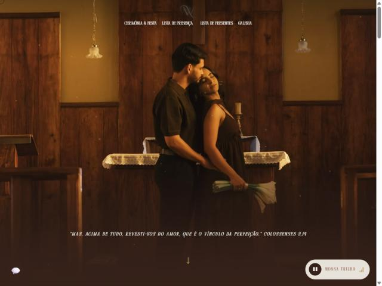
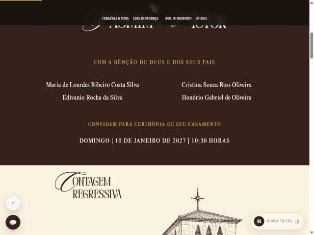
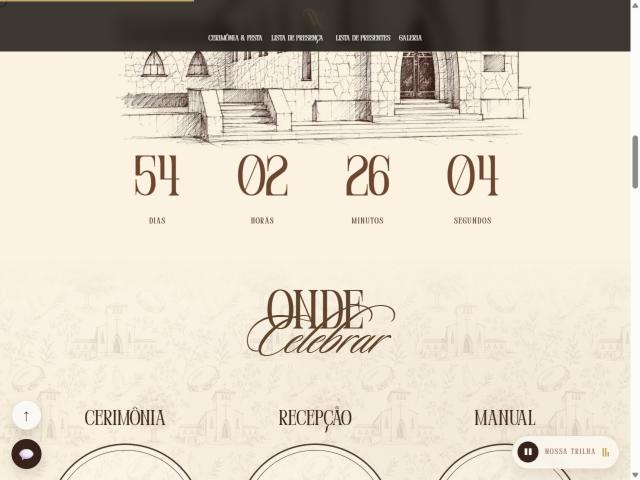

# Yasmim & Victor - Site de Casamento

Site de casamento elegante e responsivo desenvolvido para Yasmim & Victor, com cerimonia marcada para 10 de Janeiro de 2027.

## Preview

**Acesse o site ao vivo:** [yasmimevictor.blog.br](https://yasmimevictor.blog.br/)

### Screenshots

| Envelope | Hero |
|----------|------|
|  |  |

| Convite Formal | Contagem Regressiva |
|----------------|---------------------|
|  |  |

## Funcionalidades

- Animacao de abertura com envelope interativo
- Galeria de fotos do casal com lightbox
- Contagem regressiva para o grande dia
- Secao "Nossa Historia" com timeline animada
- Informacoes da cerimonia e recepcao
- Lista de presenca com confirmacao (RSVP)
- Lista de presentes
- Player de musica integrado
- Design totalmente responsivo (mobile + desktop)
- Ilustracao de igreja como fundo da contagem regressiva

## Tecnologias

- HTML5 / CSS3 / JavaScript
- Design responsivo com CSS Grid e Flexbox
- Animacoes CSS e scroll reveal
- Fontes customizadas (Perandory, Sloop Script Pro)
- Imagens otimizadas em WebP

## Autor

Desenvolvido por **David** - [Gennessis Engenharia](https://github.com/Daavi007)
